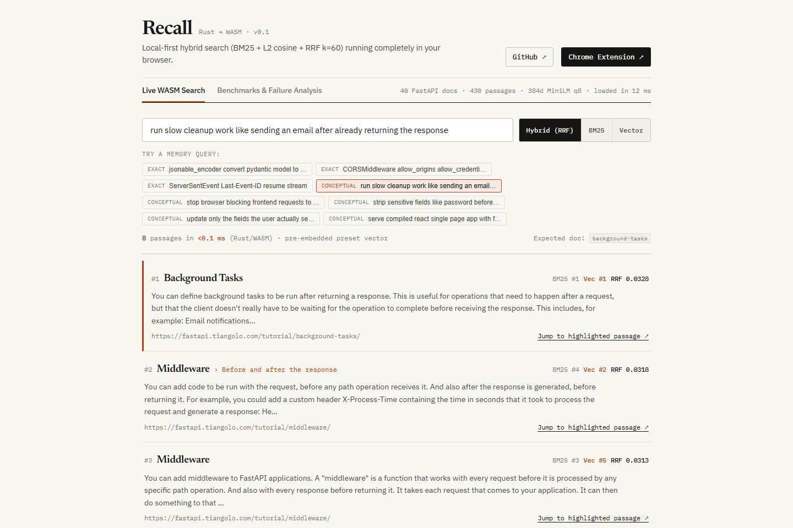
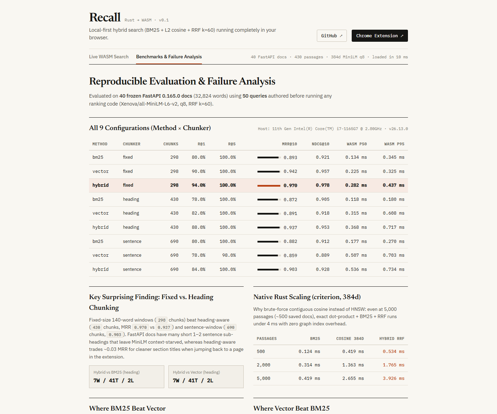

# Recall

Local-first hybrid search for pages you have read. Save a documentation page or article in Chrome, search it later from memory using keywords or rough concepts, and jump straight back to the highlighted passage on the original page.

No server, no account, and no page content leaving the browser. The search engine is written in Rust, compiled to WebAssembly, and paired with local embeddings in an MV3 extension and a browser demo.





## Why

Browser history only matches page titles and URLs. Bookmarks pile up without searching the actual text inside them. If you remember *reading* an explanation of dependency overrides or background tasks last week—but not the title or exact wording—standard history search misses it.

Recall indexes saved passages locally and combines:
- **BM25** for exact identifiers, flags, error codes, and technical terms
- **Brute-force L2-normalized cosine similarity** over dense embeddings for paraphrased or conceptual queries
- **Reciprocal Rank Fusion (RRF, `k = 60`)** to merge both rankings without tuning fragile score weights

Brute-force cosine is intentional here: for a personal reading index of a few thousand passages, a contiguous `f32` dot product is fast, deterministic, easy to serialize into IndexedDB, and avoids the memory and deletion overhead of an approximate graph index (HNSW).

## Architecture

```text
crates/
  recall-core/   # Tokenizer, chunkers, BM25, cosine vector store, RRF fusion, snapshots
  recall-cli/    # Native terminal indexer and search runner for local testing & eval
  recall-wasm/   # wasm-bindgen bindings compiled via wasm-pack for Chrome & web demo
eval/            # Frozen docs corpus manifest, hand-written queries, and benchmark runner
extension/       # Chrome MV3 extension (activeTab save, offscreen WASM + embeddings, IndexedDB)
web/             # Public zero-install demo with pre-indexed corpus and benchmark views
```

## Benchmarks

Measured against a frozen snapshot of 40 FastAPI tutorial docs (`v0.165.0`, 32,824 words) using 50 pre-written queries committed in [eval/queries.jsonl](eval/queries.jsonl) prior to running [eval/run_benchmark.mjs](eval/run_benchmark.mjs) (`Xenova/all-MiniLM-L6-v2` `q8`, `recall-wasm`, Intel i7-1165G7, Node v26.13):

| Method | Chunker (chunks) | R@1 | R@5 | MRR@10 | NDCG@10 | p50 (ms) | p95 (ms) |
| --- | --- | ---: | ---: | ---: | ---: | ---: | ---: |
| BM25 | Fixed (298) | 80.0% | 100.0% | 0.893 | 0.921 | 0.134 | 0.345 |
| Vector | Fixed (298) | 90.0% | 100.0% | 0.942 | 0.957 | 0.225 | 0.325 |
| **Hybrid (RRF)** | **Fixed (298)** | **94.0%** | **100.0%** | **0.970** | **0.978** | **0.282** | **0.437** |
| BM25 | Heading (430) | 78.0% | 100.0% | 0.872 | 0.905 | 0.118 | 0.180 |
| Vector | Heading (430) | 82.0% | 100.0% | 0.891 | 0.918 | 0.315 | 0.608 |
| **Hybrid (RRF)** | **Heading (430)** | **88.0%** | **100.0%** | **0.937** | **0.953** | **0.368** | **0.717** |
| BM25 | Sentence (690) | 80.0% | 100.0% | 0.882 | 0.912 | 0.177 | 0.270 |
| Vector | Sentence (690) | 78.0% | 98.0% | 0.859 | 0.889 | 0.507 | 0.703 |
| **Hybrid (RRF)** | **Sentence (690)** | **84.0%** | **100.0%** | **0.903** | **0.928** | **0.536** | **0.734** |

- **Native Rust scaling (`criterion`, 384-dim):** Hybrid RRF runs in `0.53 ms` at 500 passages, `1.77 ms` at 2,000 passages, and `3.93 ms` at 5,000 passages.
- **Key surprise:** Fixed-size 140w chunking beat heading-aware (`MRR 0.970` vs `0.937`) because FastAPI docs contain many 1–2 sentence sub-sections that starve MiniLM of context; heading-aware trades ~0.03 MRR for cleaner jump-back section titles.
- See [docs/benchmarks.md](docs/benchmarks.md) for per-category scores, concrete failure cases (including queries where Hybrid lost to BM25 or Vector), and raw JSON artifacts.

## Installing the Unpacked Chrome Extension

```bash
cd extension
npm ci --ignore-scripts
npm run build
```

1. Open `chrome://extensions` in Chrome and enable **Developer mode**.
2. Click **Load unpacked** and select `extension/dist`.
3. Open any documentation page or article, press `Alt+K` (or click the Recall toolbar icon), and click **Save this page**.

See [docs/embedding-spike.md](docs/embedding-spike.md) for measured `all-MiniLM-L6-v2` (`q8`) download size, per-page indexing timings, and MV3 offscreen/CSP notes, [PRIVACY.md](PRIVACY.md) for the Chrome Web Store privacy policy, and [extension/STORE_LISTING.md](extension/STORE_LISTING.md) for submission copy and permission justifications.

## Development

```bash
# Run Rust tests across the workspace
cargo test --workspace

# Run microbenchmarks
cargo bench -p recall-core

# Build the WebAssembly package
wasm-pack build crates/recall-wasm --target web --release

# Typecheck, test, and build the Chrome extension
cd extension && npm run build && npm run typecheck && npm test

# Run the public zero-install web demo locally (or deploy `web/` directly to Vercel)
cd web && npm ci --ignore-scripts && npm run dev
```

## Limitations (v0.1 scope)

- Click-to-save only (`activeTab`); does not passively scrape browsing history.
- Focused on readable documentation pages and articles; PDFs, login-walled apps, and heavy canvas SPAs are out of scope for v0.1.
- Brute-force cosine targets personal reading scale (up to ~10k–20k passages), not web-scale corpora.
